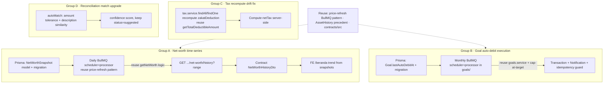

# Plan: Shape EPIC-014 — Feature Maximizers (Wealth Intelligence)

## Context

The goal is to **author one new epic document** (not write code) that turns already-stored
WealthMe data into product value — "maximize the features that already exist." A two-round,
line-level audit against the actual code dropped several claims that didn't survive reading:

- **Budget alerts** already fire solidly (`transactions.service.ts:171-243`, 80% threshold + email + notification).
- **DTO validation** is already enforced (global `ValidationPipe` at `main.ts:29`; class-validator on DTOs).
- **Donations → tax** is already wired (`tax.service.upsertByYear()` sums deductible donations into
  `zakatDeduction`; `/tax` page already shows it). Only a narrow drift gap remains (see Task C).

What survived as genuine, high-value gaps (all confirmed in code):

| #   | Gap                                                                                                                                                                                                                                               | Evidence                                                              |
| --- | ------------------------------------------------------------------------------------------------------------------------------------------------------------------------------------------------------------------------------------------------- | --------------------------------------------------------------------- |
| A   | No persisted **net-worth history**. `getSummary` sparkline is a 30-day _transaction-flow_ proxy (`dashboard.service.ts:155-173`), not a wealth trend; beranda consumes `summary.sparkline` (not `SPARKLINE_POINTS`). No `NetWorthSnapshot` model. | `dashboard.service.ts:43-263`, `beranda/page.tsx:83-189`              |
| B   | `Goal.autoDebitAmount` is stored but **never executed** — no cron/scheduler touches it. Only scheduled job in the app is `price-refresh`.                                                                                                         | `schema.prisma:363`, `goals.service.ts`, `price-refresh.scheduler.ts` |
| C   | Donations→tax is wired, but read paths (`findAll`/`findOne`) return stored `zakatDeduction` without recompute → **drift** when donations change after save; and `netTax` is taken verbatim from client input, never computed server-side.         | `tax.service.ts:51-104`                                               |
| D   | Reconciliation auto-match is naive: **exact** amount + date ±1 day, no nominal tolerance, no description similarity → false negatives.                                                                                                            | `reconciliation.service.ts:180-221`                                   |

**User decisions:** theme = Feature Maximizers; Task C kept but **reframed narrow** (drift fix +
server-side netTax); RLS/security split out to a separate follow-up (EPIC-015), noted only, not created here.

**Reuse, don't reinvent (all verified to exist):**

- BullMQ repeatable job pattern: `price-refresh.scheduler.ts` (`queue.add(JOB, {}, { repeat: { every }, jobId })` in `onModuleInit`) + `@Processor("queue")` extending `WorkerHost` (`price-refresh.processor.ts`) + `BullModule.registerQueue({ name })` (`investments.module.ts`).
- History-table precedent already in schema: `AssetHistory` (`schema.prisma:404-413`).
- Comprehensive net-worth math already written: `dashboard.service.getNetWorth()` (`dashboard.service.ts:216-263`) — accounts + investments + assets − liabilities. (Note: `getSummary` netWorth at line 65 only counts accounts + assets — snapshots should reuse the comprehensive `getNetWorth` logic.)
- Donation aggregation already written: `donationsService.getTotalDeductibleAmount(fgId, year)`.
- Contracts live in `packages/contracts/src/<domain>/index.ts` (e.g. `dashboard`, `goals`, `tax`).
- FE data access: `apiFetch` + `useQuery` keyed by `familyGroupId` (`lib/api-client.ts`, `lib/query-keys`); charts in `@/components/charts` (`Sparkline`, `BarChart`, `Donut`).

**Wiring notes (flow integrity — verified, these affect how A/B are built):**

- **BullMQ root is NOT app-global.** `BullModule.forRootAsync({ connection: { url: REDIS_URL } })`
  is registered _inside_ `investments.module.ts:22-28`. So a new queue-owning module (DashboardModule
  for A, GoalsModule for B) must mirror the **full** block — import `ConfigModule` +
  `BullModule.forRootAsync(...REDIS_URL)` + `BullModule.registerQueue({ name })` — not just `registerQueue`.
- **Route param is `familyGroupId`, not `id`.** Controller is `@Controller("family-groups/:familyGroupId/dashboard")`
  with CASL `@CheckAbility((ab) => ab.can("read", "Account"))` on each route (`dashboard.controller.ts`).
  The history route is `@Get("net-worth/history")` + `@Query("range")`, same guard.
- **`DashboardModule` currently imports nothing** (PrismaModule is global); adding the snapshot job
  means it newly needs `ConfigModule` + Bull as above.
- **Net-worth math is inconsistent today:** `getSummary.netWorth` (`dashboard.service.ts:65`) counts only
  accounts+assets, while `getNetWorth()` (216) counts accounts+investments+assets−liabilities. Snapshots
  must reuse the **comprehensive `getNetWorth` breakdown**; Task A should note (and ideally align) the
  `getSummary` discrepancy so the trend and the headline number agree.

## Deliverable (this plan = docs only)

1. **New file** `docs/epics/EPIC-014-feature-maximizers.md`, mirroring the structure of
   `docs/epics/EPIC-012-master-coa.md`.
2. **Edit** `docs/epics/README.md`: add the EPIC-014 row, and fix two stale rows —
   EPIC-012 (`backlog` → `ready-for-qa`) and EPIC-013 (`on-progress` → `done`) to match their
   own frontmatter.

Implementation of the code itself is out of scope here; it runs later via
`/task-work EPIC-014 <group>` once the epic is set to `status: on-progress`.

## Epic document structure

Mirror `EPIC-012` section-for-section: frontmatter → `## Goal` → `## Tasks` (checkbox list,
one `- [ ] ### <Letter> — <Title>` line per group with indented subtasks) → `## Evidence`
(the file:line references above) → `## Scope` (`### A`…`### D` detail) → `## Acceptance Criteria`
→ `## Test Plan` → `## Agent Routing` → `## Automation Log`.

Frontmatter:

```
# EPIC-014: Feature Maximizers (Wealth Intelligence)

status: backlog
environment: dev
retries: 0
phase: 4
priority: P1
area: Backend + Frontend
source: code audit 2026-06 (see Evidence)
```



### Group A — Net-worth time-series (real wealth trend)

- **Prisma** (`apps/api/prisma/schema.prisma`): add `NetWorthSnapshot { id, familyGroupId, capturedAt, totalCash, totalInvestments, totalAssets, totalLiabilities, netWorth }` — all monetary fields `BigInt`, `@@index([familyGroupId, capturedAt])` (follow `AssetHistory:404-413`). Generate migration.
- **Scheduler + processor** under `apps/api/src/dashboard/` (copy `price-refresh.{scheduler,processor}.ts` shape): daily job that, per family group, computes the breakdown by **reusing `getNetWorth()` logic** and writes one snapshot row. Use a fixed `jobId` so it stays a single repeatable cron. Register the queue in `DashboardModule` by mirroring the InvestmentsModule Bull block (ConfigModule + `forRootAsync` REDIS_URL + `registerQueue` + the two providers) — see Wiring notes.
- **Endpoint**: `@Get("net-worth/history")` on the existing `DashboardController` (full path `GET /family-groups/:familyGroupId/dashboard/net-worth/history?range=30d|12m`), `@Query("range")`, reusing the existing `@CheckAbility((ab) => ab.can("read", "Account"))` guard.
- **Contract**: `NetWorthHistoryDto` in `packages/contracts/src/dashboard/index.ts`.
- **FE** (`apps/web/src/app/(app)/beranda/page.tsx`): fetch history via `apiFetch`/`useQuery` and render the wealth trend from real snapshots, reusing `@/components/charts` `Sparkline` (a dedicated line/trend chart can be added if the design needs more than the sparkline). Keep the existing transaction-flow sparkline fallback until snapshots accumulate.

### Group B — Goal auto-debit execution

- **Prisma**: add `Goal.lastAutoDebitAt DateTime?` (idempotency) + migration.
- **Scheduler + processor** under `apps/api/src/goals/` (reuse BullMQ repeat pattern): monthly job — for each goal with `autoDebitAmount`, increment `currentAmount` (cap at `targetAmount`), update `status`, write a `Transaction` (category "Tabungan & Investasi") and a `Notification`. Guard with `lastAutoDebitAt` so a given month never double-debits. Reuse `goals.service` write paths. `GoalsModule` already imports PrismaModule but **not** Bull — add the same ConfigModule + `forRootAsync` + `registerQueue` block as Wiring notes.
- **Tests**: idempotency (re-run same month is a no-op) + cap-at-target.

### Group C — Tax recompute drift fix (narrow)

- **`tax.service.ts`**: in `findAll`/`findOne`, recompute `zakatDeduction` per record year via `donationsService.getTotalDeductibleAmount(familyGroupId, taxYear)` so reads never show stale deductions; compute `netTax` server-side from `grossIncome`, `ptkp`, and `zakatDeduction` instead of trusting client `dto.netTax`. (Do **not** re-add the already-working upsert wiring.)
- **FE** `/tax`: no new feature — confirm the displayed `zakatDeduction`/`netTax` now reflect recomputed values.
- **Tests**: read-after-donation-change reflects new deduction; netTax computed correctly.

### Group D — Reconciliation match upgrade

- **`reconciliation.service.ts` `autoMatch`** (currently `180-221`): add nominal tolerance (±N IDR or ±%) and simple description similarity (token overlap / contains), attach a confidence score, keep `reconStatus = "suggested"` (never auto-confirm).
- **Tests**: near-amount and similar-description cases that the exact-match logic currently misses.

Each group's exit includes: `bash scripts/{qa,test,security-check}.sh` green + an `## Automation Log` entry.

## Out of scope (recorded in the epic, not built here)

- RLS Postgres + tenant-isolation audit → **EPIC-015 Security Hardening** (follow-up, not created now).
- Real FX/storage/market-data integrations, observability (OTel/Sentry), real PDF/XLSX export,
  coverage sweep + CI enforcement → separate hardening epic.
- Dead-code cleanup in `lib/data.ts` / `resolveAiResponse` → minor chore, not an epic.

## Verification (of this docs change)

- `git status` shows exactly: new `docs/epics/EPIC-014-feature-maximizers.md` + modified `docs/epics/README.md`.
- New file's frontmatter and section order match `EPIC-012`; every Evidence reference resolves to a
  real path/line listed above.
- README table: EPIC-014 row present; EPIC-012 = `ready-for-qa`, EPIC-013 = `done` (now matching their files).
- (Code gates `scripts/{qa,test,security-check}.sh` apply later, per task group, during `/task-work`.)
